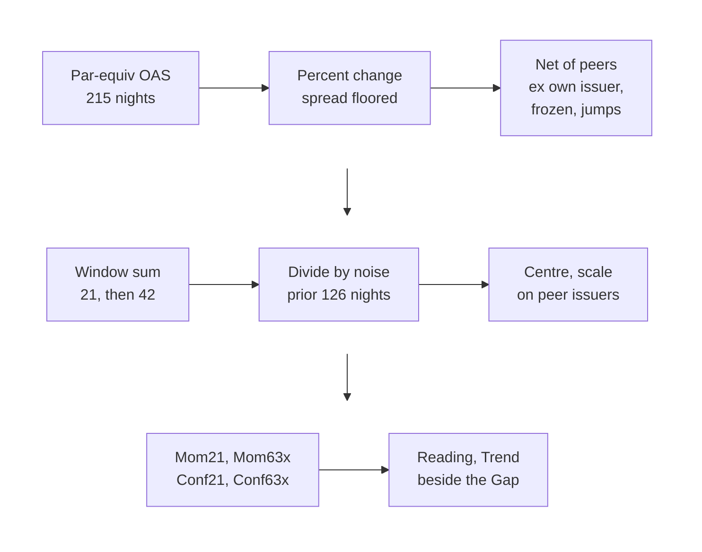

<div align="center">

# OAS Relative Momentum

[](https://www.python.org/downloads/)
[](oasmom.py)
[](#tests)
[](oas_relative_momentum_spec.md)
[](#the-columns)

**[The Question](#the-question-this-module-asks)** &nbsp;&middot;&nbsp; **[Columns](#the-columns)** &nbsp;&middot;&nbsp; **[Reading a Row](#how-to-read-a-row)** &nbsp;&middot;&nbsp; **[Fine Print](#the-fine-print-a-pm-should-carry-around)** &nbsp;&middot;&nbsp; **[Quick Start](#quick-start)** &nbsp;&middot;&nbsp; **[Tests](#tests)** &nbsp;&middot;&nbsp; **[Files](#where-the-exact-rules-live)**

## How unusual was this bond's month, against its own history and its own peers?

</div>

<br>

What if ten thousand bonds could each tell you a story?

Each one would tell you where it stands, the way every screen already does, and also where it has been going, who it has been running with, and the moment it broke from the pack. What if the data on your desk, the same spreads you look at every morning, had been carrying that story all along, and nobody had built the way to read it?

It has. This is the way to read it.

## The bond that moved while nobody was looking

Picture a Tuesday in an investment grade portfolio. The index holds about ten thousand bonds. The portfolio manager owns a few hundred of them and has an opinion on maybe forty. The rest sit in a spreadsheet, each with a spread, a rating and a sector, and every morning the spreadsheet refreshes and every morning almost nothing about it looks different.

That is the trick of investment grade credit. It is designed to look calm. Spreads move a basis point here, two there. A bond that was 112 over last month is 109 over this month, and its sector went from 105 to 101, and nobody in the building has the time to notice that the bond just lagged its neighbours by a full point of percentage spread, quietly, for twenty-one straight sessions.

Somebody noticed, though. Somebody always does. The people who sell a bond before the downgrade rarely announce themselves. They trim a little on Monday, a little more on Thursday, and the evaluated price drifts out a basis point at a time while the sector next door tightens on good earnings. By the time the move is large enough to see on a screen, it has usually already happened.

This module exists to see it sooner.

## What everybody already had

Every credit desk has a way to say whether a bond is cheap. Ours is the relative value engine. It sorts the index into cells of bonds that should trade alike (same sector, same subsector, same structure, same seniority, same rating bucket, same maturity bucket), fits a curve through each cell, and publishes one number per bond: the **Gap**. A Gap of +10 means the bond trades 10 basis points wider than its peers. A Gap of -10 means 10 tighter.

> The Gap is a photograph. It tells you where the bond is standing. It says nothing about which way the bond is walking.

And the walk is where the information lives. Two bonds can both sit 20bp cheap to their curve. One got there over two years and has not moved since; the market has looked at it, shrugged, and decided it deserves to be there. The other was fair a month ago and has been sliding out every week. Same photograph. Completely different stories. A PM who treats them the same will, sooner or later, buy the second one at the wrong moment.

## The question this module asks

> **Over the last month, did this bond's spread tighten or widen more than the bonds that look like it?**

That is the whole question. Everything else in the module exists to answer it honestly.

Honesty turns out to be the hard part, because the obvious answer is wrong in about five different ways.

**The obvious answer measures the market.** Most of what any IG bond does in a month is what all IG bonds did in that month. Strip that out or you are measuring beta and calling it insight. So every bond is measured against a benchmark built from its own peer cell, and the benchmark is built from everyone in the cell except the bond's own issuer. An issuer cannot be its own yardstick.

**The obvious answer treats basis points as equal.** A 10bp move on a 60bp utility and a 50bp move on a 300bp BBB- cyclical are the same move per unit of risk. So spread changes are measured in percentage terms, with a floor under very tight bonds so a 20bp name does not produce absurd percentages.

**The obvious answer trusts every print.** Evaluated prices are not trades. Some bonds get re-marked once in a week and sit frozen in between. Some get a single bad print that jumps 40% overnight and snaps back. If those go into the benchmark, one stale line can make every bond in its cell look like it moved. So frozen bonds and jumps are kept out of everyone else's benchmark that night, and a single issuer's bad night has a bounded effect on its neighbours.

**The obvious answer ignores the bond's personality.** A 5% relative move on a sleepy single-A utility is an event. The same 5% on a volatile BBB- name is a Tuesday. So each bond's move is divided by its own normal noise, measured over the six months before the window starts, with a correction for the way evaluated spreads partly reverse from one night to the next.

**The obvious answer forgets the room.** After all that, a bond's score still has to be read against the other issuers in its peer group. If the whole cell widened, nobody in it underperformed; that is a sector story, and it belongs to the sector view. So the final number is centred on the median issuer of the bond's reference group and scaled by how widely that group's scores spread. A move the whole group shared drops out of every member's score, the same way it drops out of the Gap.

What survives all five corrections is a single number per bond that says, in plain terms: this is how unusual this bond's month was, against its own history and against its own peers.



## The columns

A PM sees one row per bond.

| ISIN | Issuer | Gap (+ wide) | Mom21 (+ tightened) | Conf21 | Mom63x | Conf63x | Reading | Trend |
|---|---|:---:|:---:|:---:|:---:|:---:|---|---|
| US00000AAA11 | Issuer A | +18 | +1.6 | A | +0.4 | A | cheap and outperforming | new |
| US00000BBB22 | Issuer B | +25 | -2.3 | A | -1.3 | B | cheap and underperforming | continuing |
| US00000CCC33 | Issuer C | -15 | -1.4 | B | +2.1 | A | rich and underperforming | reversing |
| US00000DDD44 | Issuer D | -8 | +1.2 | A | | | rich and outperforming | |
| US00000EEE55 | Issuer E | +12 | | | +0.9 | A | window not covered | |

**Gap** is where the bond stands: basis points wide (+) or tight (-) of its peer group, straight from the relative value engine.

**Mom21** is how the bond walked over the last 21 trading nights, in units of its own normal monthly noise. +1.5 means it tightened against its peers by one and a half times its ordinary monthly move. -1.5 means it widened against them by the same amount. Zero means it moved with the median issuer in its group.

**Mom63x** is the same measure over the two months before that: the 42 trading nights that end where Mom21 begins. The two windows never overlap, so the pair shows whether the recent walk continues an older one or turns against it.

**Conf21 and Conf63x** say how far each number can be taken at face value. A means the move built up across the window, no jump event started inside it, and a deep peer group stands behind the comparison. B means one of those is weaker. C means the number is driven by a single event, and the right response is to go read about the event.

**Reading** puts Gap and Mom21 into words. **Trend** puts Mom63x and Mom21 into words.

## How to read a row

Look at Issuer B. It is 25bp cheap to its peers. Over the last month it widened against them by 2.3 times its normal monthly move, with a clean A grade, and the two months before that it was already widening. The Reading says **cheap and underperforming**. The Trend says **continuing**.

A PM who looked only at the Gap would see a bond 25bp cheap and think about buying it. The row says something more specific: the market has been marking this bond down against its neighbours for three months, steadily, on clean prints, and has not stopped. Someone knows something, or thinks they do. That is the question to go answer before adding a dollar.

Now look at Issuer C. It is 15bp rich. For two months it tightened hard against its peers (Mom63x +2.1). This month it turned and widened (Mom21 -1.4). Reading: **rich and underperforming**. Trend: **reversing**. A bond that ran rich is giving some of it back.

Issuer A is 18bp cheap and tightened against its peers this month, after two quiet months. **Cheap and outperforming**, **new**. The statistic does not say whether the gap will keep closing. It says the bond has started to move, and that the move is larger than an ordinary month for that bond.

The labels follow two thresholds. Cheap is a Gap of +5bp or wider, rich is -5bp or tighter, fair is in between. A Mom value counts as a move at +1.0 or beyond (outperforming) or -1.0 or beyond (underperforming); inside that it is flat. In a quiet book about one in three bonds carries a move label on any given night, so a label marks the top third of moves by size. A Mom of 2 or more is unusual both for the bond's own history and against its peer group, and with an A grade it is worth a look whether or not the bond has a Gap view.

| | Mom21 +1.0 or above | Mom21 between | Mom21 -1.0 or below |
|---|:---:|:---:|:---:|
| **Cheap** | cheap and outperforming | cheap and flat | cheap and underperforming |
| **Fair** | fair and outperforming | fair and flat | fair and underperforming |
| **Rich** | rich and outperforming | rich and flat | rich and underperforming |

| Mom63x | Mom21 | Trend |
|---|---|---|
| move | same direction | continuing |
| move | opposite direction | reversing |
| flat | move | new |
| move | flat | faded |
| flat | flat | flat |

## The fine print a PM should carry around

> [!IMPORTANT]
> **Gap and Mom point opposite ways.** A positive Gap is wide (cheap). A positive Mom is relative tightening (outperformed). The Reading column exists so nobody has to reconcile the two signs by eye at 7am.

**A month has a hard edge.** Mom21 is a straight 21-night sum. An event sits in it at full weight for exactly 21 nights and then moves into Mom63x. A Reading can change on the 22nd night with no new information; from then on the event shows in Trend.

**A fallen angel changes peers overnight.** When the index table moves a bond to a new rating bucket, its whole history is scored against the new bucket's members. The first month after a downgrade compares the bond's old life to its new neighbours, and the downgrade move usually carries a jump event, so the grade is B or C.

**A blank is information.** A bond without a score shows blank, never zero, and the Reading column says why: a new issue without enough history, a callable inside 91 days, stale marks, a window with too many missing nights. Issuer E above has gaps in the last month, so Mom21 is blank and the Reading says **window not covered**.

**Check the night.** Every row carries `as_of`, the trading night it was scored on. On an evening when half the market has printed and half has not, the engine scores the last night most bonds agree on.

**Issuers roll up.** Ask for an issuer and every line is scored, then averaged into one row weighted by size, spread duration and spread, carrying the worst line's grade and a count of how many lines went in.

## Why it matters

Investment grade credit rewards patience and punishes inattention, and the two look identical from the outside. A desk with ten thousand bonds and a dozen people cannot watch every walk. It can watch every photograph, and it already does.

This module hands the desk the walk. Every bond, on request, measured against the bonds that should trade like it, scaled to its own temperament, cleaned of the market, cleaned of bad prints, and graded for how much of the move to believe. It will not tell anyone what to buy. It will tell them which cheap bonds the market has been quietly marking down, which rich bonds have started to give it back, and which names moved last month by an amount that bond almost never moves.

Those are the bonds somebody else already noticed. Now we notice too.

---

## Quick start

`oasmom.py` is a single file with no dependencies. This repo holds the momentum module only, so three inputs come from your own stack:

| Input | Contract |
|---|---|
| `current` | `{isin: row}` from the index table. Each row carries `issuer_id`, `spread_dur`, `ttm_years`, `amount_outstanding`, `call_status` (`bullet`, `callable` or `unknown`), `rating_bucket`, and three nested peer ids: `cell_fine`, `cell_wide`, `cell_l3` |
| `fetch` | `fetch(isins) -> {isin: {datetime.date: par_equiv_oas}}`: daily par-equivalent OAS in bp, 215 trading nights for a full history |
| `gap` | The relative value engine's Gap in bp, passed through to the display row. `None` when the engine has none |

This example runs as is from the repo root. It simulates 48 issuers and plants a widening in one of them over the last 21 nights:

```python
import math
import random
from datetime import date, timedelta

import oasmom

random.seed(7)

nights = []
night = date(2026, 10, 30)
while len(nights) < 215:
    if night.weekday() < 5:
        nights.insert(0, night)
    night -= timedelta(days=1)

current = {
    f"US{i:09d}0": {
        "issuer_id": f"Issuer {i}",
        "spread_dur": 6.0,
        "ttm_years": 7.0,
        "amount_outstanding": 500.0,
        "call_status": "bullet",
        "rating_bucket": "BBB",
        "cell_fine": f"Sector {i % 2}|Sub {i % 4}|bullet|SR|BBB|5-7",
        "cell_wide": f"Sector {i % 2}|bullet|SR|BBB|5-7",
        "cell_l3": "bullet|SR|BBB|5-7",
    }
    for i in range(48)
}
target = "US0000000000"

# 1% nightly noise; the target also widens 0.5% a night over the last 21 nights
spreads = {}
for isin in current:
    oas = 100.0
    spreads[isin] = {}
    for t, night in enumerate(nights):
        drift = 0.005 if isin == target and t >= len(nights) - 21 else 0.0
        oas *= math.exp(drift + random.gauss(0, 0.01))
        spreads[isin][night] = oas


def fetch(isins):  # in production: the Bloomberg pull composed with ParEquivOAS
    return {isin: spreads[isin] for isin in isins}


bonds, issuers, diag = oasmom.request(current, fetch, [target])
row = oasmom.display_row(target, bonds.get(target), gap=25.0, dg=diag[target])
print(f"{row['Issuer']}: Mom21 {row['Mom21']:+.1f} ({row['Conf21']}), "
      f"Mom63x {row['Mom63x']:+.1f} ({row['Conf63x']}), {row['Reading']}, {row['Trend']}")
```

```text
Issuer 0: Mom21 -2.0 (A), Mom63x -0.7 (A), cheap and underperforming, new
```

| Call | Scores |
|---|---|
| `request(current, fetch, [isin, ...])` | A list of bonds, pulling only the cells they sit in |
| `request(current, fetch, {"issuer": issuer_id})` | Every line of an issuer, plus the issuer roll-up |
| `request(current, fetch)` | Every bond in the table |
| `batch(current, fetch)` | Every bond, plus the month-end `tables` to persist and pass back as `request(..., tables=tables)` |

## Tests

```bash
python test_oasmom.py             # 42 tests, about 90 seconds
python test_oasmom.py --runtime   # adds the 7,000 bond timing test
```

Every test asserts, and every test runs on synthetic spreads. The null calibration test simulates a market with no momentum in it: 3,500 bonds over 230 nights on each of two seeds, 7,000 scores in all. A scale that is honest should make those scores look like unit noise.

| Null calibration | Raw score | Mom21 (z) | Unit normal |
|---|:---:|:---:|:---:|
| Standard deviation | 1.020 | 1.036 | 1.000 |
| Share beyond 2 | 4.73% | 5.39% | 4.55% |
| Share beyond 3 | 0.43% | 0.40% | 0.27% |

On the first seed, 32.8% of Mom21 values carry a move label and 98.2% grade A. These figures check the scale. They say nothing about forward spread returns, and this repo holds no backtest on market data.

## Where the exact rules live

Every rule above is stated exactly, with every threshold, boundary and default, in the first two files below.

| File | Holds |
|---|---|
| [`README_detailed.md`](README_detailed.md) | Definitions, eligibility, blank reasons, request mechanics |
| [`oas_relative_momentum_spec.md`](oas_relative_momentum_spec.md) | Implementation guide, parameter table, reference code |
| [`oasmom.py`](oasmom.py) | Reference implementation, standard library only |
| [`test_oasmom.py`](test_oasmom.py) | The 42 tests |
